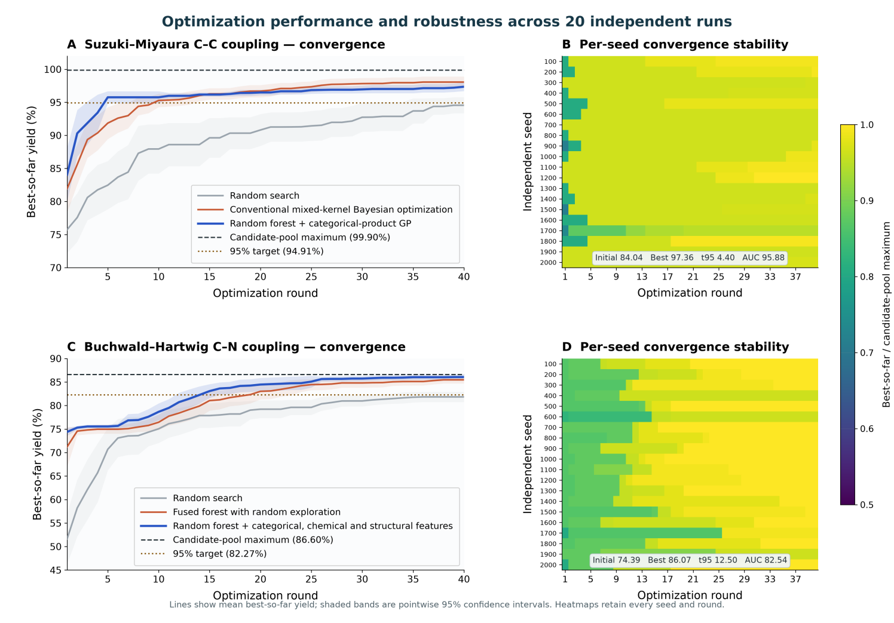
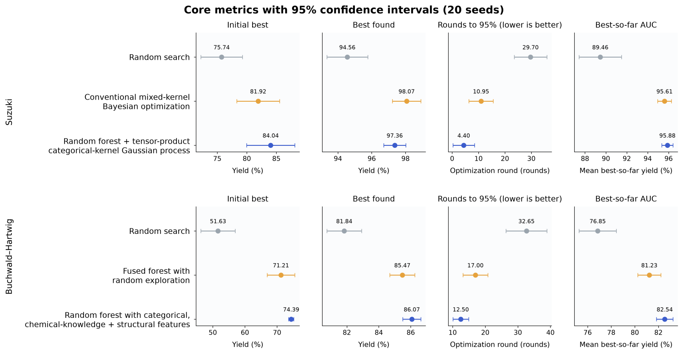

# CatalystFlow 队伍最终结果与分析

本报告所有数值均来自模型冻结后的独立顺序优化轨迹，而非对全体候选的一次性预测。

术语说明：本文所称“代理模型”是指以较低成本近似“反应条件→产率”关系的预测模型。它当然属于模型；“代理”一词强调其在顺序优化中代替昂贵真实实验（或离线预言器）输出预测均值与不确定性，从而支持候选选择。本项目的代理模型具体由随机森林和/或高斯过程实现。

## 1. 最终评测协议

数据集：Suzuki 与 Buchwald-Hartwig（项目内部数据集标识为 Buchwald\_sub4），分别独立运行；

随机种子：100、200、……、2000，共 20 个；

每个随机种子运行 40 轮，每轮只选择 1 个未查询候选；

汇总指标：均值、样本标准差和基于 t 分布的 95% 置信区间；

若未达到 t95 阈值，则记为 41；

模型在运行前冻结；测试产率仅在候选索引确定后由离线预言器（OfflineOracle）按索引返回。

本报告中 AUC 指 40 轮截至当前轮累计最优产率（best-so-far）序列的算术平均，不是分类任务中的 ROC-AUC；t95 指首次达到候选池全局最高产率 95% 的轮数。统一入口为 code/main/run\_selected.py；模型比较图和补充统计均在模型与 40 轮轨迹冻结后生成，不返回优化器，也不用于参数选择或候选排序。

## 2. 原始数据范围、全局最高值与命中情况

| 数据集 | 初始训练信息 | 候选池 | 候选池最高产率 | 需要特别说明的边界 |
| --- | --- | --- | --- | --- |
| Suzuki–Miyaura | 29 条；0–71.51% | 5,731 条 | 99.90% （3 个候选） | 无 |
| Buchwald_sub4 | 35 条跨 5 个产物；目标产物仅 7 条，初始最高 45.3883% | 783 条 | 86.5976% （1 个候选） | 81.7870% 来自其他产物的最高产率，不能写成目标产物的最高产率 |

Buchwald 任务需区分“35 条合并训练集的最高值”与“目标子集 7 条初始实验的最高值”：81.7870% 来自其他产物提供的迁移上下文，不能表述为目标任务在初始化阶段已达到的产率。下文的全局最高值和命中统计仅用于我们最终模型冻结后，运行完整轨迹的评价。

| 数据集 | 40 轮平均 best | 精确命中全局最高 | 命中 ≥99% 全局最高 | 40轮内命中 ≥95% | 前 5 轮命中 ≥95% |
| --- | --- | --- | --- | --- | --- |
| Suzuki–Miyaura | 97.3625% | 1/20（5%） | 5/20（25%） | 19/20（95%） | 19/20（95%） |
| Buchwald_sub4 | 86.0670% | 16/20（80%） | 17/20（85%） | 20/20（100%） | 0/20（0%） |

精确命中以 10⁻⁹ 的数值容差判定；≥99% 和 ≥95% 均以对应候选池的全局最高产率为基准。命中率的 Wilson 95% 区间、各随机种子结果及补充的早期曲线面积见 results/figures/supplementary\_metrics\_summary.csv 与 supplementary\_metrics\_per\_seed.csv。

## 3. 两个官方公开评测数据集的四项指标

Suzuki–Miyaura：随机森林—分类核高斯过程融合的贝叶斯优化（Bayesian optimization with a random-forest/Gaussian-process ensemble and a tensor-product kernel for categorical inputs）

模型由按反应变量分组的类别核高斯过程与随机森林组成，预测均值中随机森林权重为 0.75。候选按期望改进排序，预先冻结的均匀探索率从0.15线性降至0.01：即在少数轮次中不按 EI 而从未查询候选中均匀随机选取1条，以降低离散组合空间中过早陷入局部区域的风险；其余轮次仍按 EI 排序。详情查看技术文档doc\\method\_description.pdf。

| 核心指标 | 均值 | 标准差 | 95% 置信区间 |
| --- | --- | --- | --- |
| 首轮发现值（initial_round_found_best）↑ | 84.0425 | 8.6937 | [80.2323, 87.8527] |
| 40 轮最高值（best_found）↑ | 97.3625 | 1.3957 | [96.7508, 97.9742] |
| 达到 95% 的轮数（t95）↓ | 4.4000 | 8.7323 | [0.5729, 8.2271] |
| 全过程曲线面积（AUC_best_so_far）↑ | 95.8840 | 1.1440 | [95.3826, 96.3853] |

Buchwald–Hartwig：分类变量、化学知识与结构特征融合的随机森林（Bayesian optimization with a random forest using categorical, chemical-knowledge, and structural features）

模型同时使用独热编码分类变量、与标签无关的化学知识、32 位 Morgan 分子指纹和物化描述符，并由随机森林学习高阶交互；候选完全按期望改进排序，不叠加均匀随机探索；这不等于“不探索”，因为 EI 本身会在预测均值与不确定性之间权衡。训练内伪闭环比较显示，额外的均匀随机抽取会降低该任务的效率，因此该概率被冻结为0。详情查看技术文档doc\\method\_description.pdf。

| 核心指标 | 均值 | 标准差 | 95% 置信区间 |
| --- | --- | --- | --- |
| 首轮发现值（initial_round_found_best）↑ | 74.3877 | 1.7673 | [73.6132, 75.1623] |
| 40 轮最高值（best_found）↑ | 86.0670 | 1.2052 | [85.5388, 86.5951] |
| 达到 95% 的轮数（t95）↓ | 12.5000 | 5.1350 | [10.2495, 14.7505] |
| 全过程曲线面积（AUC_best_so_far）↑ | 82.5350 | 1.4948 | [81.8799, 83.1902] |

## 4. 优化曲线与鲁棒性图

优化曲线与鲁棒性图的呈现方式参考 Yuan 等人[1]的工作：图A、C 分别展示 Suzuki–Miyaura 和 Buchwald–Hartwig 任务在 20 个独立随机种子下的平均 best-so-far 产率随优化轮数的变化。蓝线为最终方法，橙线为模型迭代中的阶段性方法（Suzuki–Miyaura数据集为常规混合核贝叶斯优化，Conventional mixed-kernel Bayesian optimization，Buchwald–Hartwig数据集为带随机探索的融合森林，Fused forest with random exploration），灰线为随机搜索（Random Search），作为基线模型；阴影表示各轮均值的 95% 置信区间。黑色虚线表示候选池最高产率，棕色点线表示其 95% 阈值。B、D 展示最终方法在每个随机种子、每轮优化中的收敛情况；颜色表示当前 best-so-far 产率与候选池最高产率之比，颜色越接近黄色，说明越接近全局最高值。结果表明，Suzuki 任务通常能在较早轮次接近最优区域；Buchwald 任务的跨随机种子差异更明显，但大多数轨迹仍随轮数增加稳定接近候选池最高值。图内汇总框依次给出首轮发现值、40 轮最高值、t95 和全过程 AUC 的平均值。图中的 AUC 为该方法 40 个逐轮 best-so-far 均值的算术平均；由于该运算是线性的，它与“每个随机种子先算 AUC、再取均值”数值相同。

上图主要展示了四项核心优化指标及其不确定性。圆点表示 20 个独立随机种子的均值，水平误差线表示基于随机种子波动计算的 95% 置信区间。

所有数据图和 CSV 均由同一批冻结 .pt 轨迹重新计算。单独的 t95 达标曲线和高清逐 seed 热图仍保留在 results/figures/，便于复核。

## 5. 模型结果总结

Suzuki 平均在第 4.4 轮达到全局最高值的 95%，40 轮最高值为 97.36%，全过程曲线面积为 95.88，说明其早期发现能力较强。

Buchwald 候选池的最高产率为 86.60%，最终模型平均发现 86.07%，即平均达到候选池最高产率的 99.38%；t95 为 12.5，全过程曲线面积为 82.54。对于仅有 35 条跨产物初始标签的任务，这一结果具有较好的稳定性。

置信区间反映的是不同随机种子之间的波动。

补充指标如下：

Suzuki 的最终简单遗憾值（候选池最高产率减去已发现最高产率）为 2.5375 ± 1.3957；前 5、10、20 轮的曲线面积分别为 91.0846、93.4246、94.8170。

Buchwald 的最终简单遗憾值为 0.5306 ± 1.2052；前 5、10、20 轮的曲线面积分别为 75.2666、76.2062、79.4657。

被选中候选上的预测误差和 95% 覆盖率仅用于诊断模型在顺序选择中是否过度自信。

## 6. DFT 选择后解释与真实轨迹案例

DFT 解释器只在冻结优化模型已经选定候选条件后运行。它的作用是帮助理解该候选的电子结构特征，而不是参与选点。

具体来说：

模型先根据已查询数据、预测产率、不确定性和期望改进值，决定下一条实验；

oracle（真实结果查询器）返回该实验的真实产率后，才可用于结果说明；

DFT 解释器随后将候选中各组分的电子结构指标，与同一反应角色的其他已计算组分进行比较；

DFT 结果不会参与代理模型训练、期望改进计算或候选排序，也不会读取未查询候选的真实产率。

表中的“DFT 覆盖 5/5”表示该候选的五类反应组分均有可用 DFT 计算结果；“混合 / 中”表示存在同时支持与提示风险的电子结构证据，因此解释结论为混合，可信度为中等。

| 数据集与案例 | 模型预测 | 不确定性 | 期望改进值 | 查询后产率 | DFT 覆盖 | 证据/可信度 |
| --- | --- | --- | --- | --- | --- | --- |
| Suzuki seed 100 首轮，索引 193 | 52.07 | 25.65 | 3.320 | 80.63% | 5/5 | 混合 / 中 |
| Buchwald seed 100 首轮，索引 151 | 46.48 | 17.73 | 7.631 | 74.97% | 5/5 | 混合 / 中 |

seed 100：控制随机过程的固定数字。第 1 轮：模型还未从本轮得到新反馈时，首次推荐的实验。索引 193 / 151：候选条件表中的行编号或候选 ID，用于准确定位“选的是哪组底物、配体、碱、溶剂等反应条件”。它们是从完整 20 个种子、每个种子 40 轮的轨迹中，抽出的两个具体案例来展示模型推荐和 DFT 解释。

在该 Suzuki 条件中，有机硼试剂的 C–B Mayer 键级位于同类有机硼试剂的第 25 百分位，说明该键相对偏弱；硼原子电荷位于第 75 百分位。这两项特征从机理角度可视为对硼试剂活化的支持。碱的偶极矩位于第 93 百分位，说明其极性在同类碱中较高，可能影响反应环境和离子过程。但该条件也存在风险信号：6-碘喹啉的 C–离去基团键级位于第 90 百分位，说明相关键相对较强；反应碳电荷位于第 10 百分位，也提示氧化加成步骤可能面临电子效应方面的不利因素。因此，解释器不会因为最终产率较高，就将所有 DFT 特征都解释为“有利”。该案例同时存在支持证据与风险证据，因此结论为“混合 / 中等可信度”。

在该 Buchwald 条件中，配体 HOMO 位于四个已计算配体的第 88 百分位，表明该配体相对具有更强的给电子能力；这一点可作为支持配体参与催化循环的电子结构证据。同时，芳基卤代物 LUMO 位于第 90 百分位，配体磷位点电荷也位于第 88 百分位。这些较高的相对位置构成潜在风险提示，说明电子匹配和关键反应步骤仍可能存在限制。该候选最终真实产率为 74.97%。这一结果说明 DFT 解释用于展示该条件中可能同时存在的有利因素与限制因素，而不是声称某一个 DFT 指标单独决定产率。

| 数据集 | 唯一已查询条件 | 五角色完整 DFT 解释 | 完整覆盖率 |
| --- | --- | --- | --- |
| Suzuki | 357 | 321 | 89.9% |
| Buchwald_sub4 | 97 | 97 | 100.0% |

覆盖率按 20 条冻结轨迹中的唯一条件计算，不等同于全候选空间的 DFT 完整行覆盖率。对缺失角色不做数值补造，解释器会相应降低覆盖率和可信度。

轨迹结束后，项目仅使用已经合法查询得到的产率，对 DFT 指标与产率之间的关系进行了探索性检查。为避免同一组分重复出现而被误认为多个独立样本，先按反应角色和组分进行聚合，再计算 Spearman 秩相关系数。所有待检验的 DFT 指标均在分析前确定，并同时报告：

ρ：指标与产率的单调相关方向和强度；

p：未经多重比较校正的显著性；

q：经过 Benjamini–Hochberg 多重比较校正后的显著性。

结果显示，两个数据集均没有出现 q < 0.05 的稳定关联。Suzuki 中绝对值最大的描述性信号为配体磷位点电荷（ρ = -0.736，q = 0.117，11 个组分），但仍未达到可靠显著性。Buchwald 中部分指标出现了 |ρ| = 1，但对应样本只有 3 个组分，且 q = 0.720，不能视为稳定规律，更不能解释为因果关系。因此，当前 DFT 层应被视为可追溯的机理解释与风险提示工具，而不是直接决定候选排序或产率高低的模型。

完整自然语言案例见 results/dft\_explanations/dft\_explanation\_examples.md，结构化输出见同目录 JSON；覆盖率和全部预注册关联分别见 dft\_coverage\_summary.csv 与 dft\_posthoc\_associations.csv。这些结果支持将 DFT 作为可追溯的机理解释层，而不让其直接控制当前冻结排序。

## 7. .pt 完整轨迹、字段和指标重算

正式提交目录如下：

results/optimization\_trajectories/

├── Suzuki/seed\_100.pt ... seed\_2000.pt

└── Buchwald\_sub4/seed\_100.pt ... seed\_2000.pt

每个 .pt 文件均为 Python 标准库 pickle 序列化的字典，不依赖 PyTorch：

import pickle

with open("results/optimization\_trajectories/Suzuki/seed\_100.pt", "rb") as f:

payload = pickle.load(f)

seed = payload["seed"]

dataset = payload["dataset"]

records = payload["trajectory"]  # 恰好 40 条，按 step=1...40 排序

| 字段 | 含义 | 是否每轮存在 |
| --- | --- | --- |
| step | 从 1 开始的当前轮数 | 是 |
| query_index | *_test_features.csv 中的候选行索引 | 是 |
| condition | 该索引对应的全部公开条件字段 | 是 |
| observed_yield | 选择完成后离线查询器或实验返回的产率 | 是 |
| best_so_far | 截至本轮已观测产率最大值 | 是 |
| predicted_yield | 选择前代理模型对被选候选的均值预测 | 是 |
| uncertainty | 选择前后验/经验标准差 | 是 |
| acquisition_value | 选择前采集函数值 | 是 |
| selection_mode | 期望改进或冻结的均匀随机探索模式 | 是 |

每轮记录的字段如下：

四项指标均对每条随机种子轨迹独立计算。令 yᵢ 为第 i 轮观测产率，bₜ 为截至第 t 轮已观测到的最高产率：

bₜ = max(y₁, y₂, …, yₜ)

首轮发现值 = b₁

40 轮最高值 = b₄₀

全过程曲线面积 = (b₁ + b₂ + … + b₄₀) / 40

若 y★ 表示候选池全局最高产率，则 t95 为首个满足 bₜ ≥ 0.95 × y★ 的轮数；若 40 轮内未达到，则记为 41。随后对 20 个随机种子的指标报告算术均值、样本标准差和基于 t 分布的 95% 置信区间：

95% 置信区间 = 样本均值 ± t₀.₉₇₅₁₉ × 样本标准差 / √20

results/figures/trajectory\_schema.json 提供机器可读 schema；trajectory\_field\_audit.csv 证明 40 个文件均为连续 40 步、候选索引不重复且必需字段完整；supplementary\_metrics\_per\_seed.csv 可直接审计各 seed 的主指标和补充指标。

## 8. 外部兼容性检查

### 8.1 官方两套数据

两套任务不共用产率标签或模型状态；

Buchwald 的产物字段保留为上下文信息，公开候选中固定为目标产物；

Suzuki 的 5 个离散变量均进入表示；

候选表不含 Yield，且条件表示保持一一可区分；

20×40 的 40 个轨迹文件均通过提交校验。

### 8.2 第三方 Buchwald 压力测试

AstraZeneca/ORD 的 750 条原始记录中，6 条产率超过 100% 的记录在划分、特征构建和训练前被删除，保留 744 条。10 个随机种子 × 40 轮的结果如下：

| 方法 | initial ↑ | best ↑ | t95 ↓ | AUC ↑ |
| --- | --- | --- | --- | --- |
| 随机搜索 | 41.24 | 92.68 | 33.60 | 83.58 |
| 分类变量随机森林 | 46.15 | 94.61 | 21.40 | 90.27 |
| 分子结构随机森林 | 46.76 | 98.37 | 14.60 | 92.03 |
| 分类变量—化学知识—结构特征融合随机森林 | 53.06 | 97.63 | 17.50 | 91.02 |

结构表示明显改善了可迁移性，但“纯结构”和“融合结构”在不同指标上各有优势。

### 8.3 第三方 Suzuki 压力测试

| 方法 | initial ↑ | best ↑ | t95 ↓ | AUC ↑ |
| --- | --- | --- | --- | --- |
| 随机搜索 | 52.61 | 94.74 | 28.50 | 90.85 |
| 混合变量随机森林 | 62.76 | 99.54 | 18.30 | 95.03 |
| 连续/类别混合核—森林代理 | 86.31 | 99.77 | 8.90 | 97.61 |

Reizman 流动反应包含额外连续变量。字段适配器保留并标准化这些变量，而非直接删列。10 个随机种子 × 40 轮的结果如下：

这里验证的是完整架构的兼容性：先按字段类型建立表示，再由混合代理预测，最后按期望改进排序。外部适配器使用适合连续变量的径向基函数核，并不等同于官方全类别 Suzuki 的可交换分类协方差函数的张量积核，因此不将该结果表述为最终类别核代理的直接外推成绩。

## 9. 智能体独立复现、已查询 Top-5 反应条件与最终推荐反应条件

使用独立 test Conda 环境重新执行 2 × 20 × 40 正式复现实验。由 Open Science 智能体直接读取包内组织方原始数据 data/，新建作业并完成相同协议。两次运行均不是加载随包轨迹，而是使用固定模型配置 从头拟合代理模型并逐轮查询。结果如下：

| 审计项 | 结果 |
| --- | --- |
| 新生成轨迹 | 40/40 合法 |
| 顺序查询记录 | 1,600/1,600 完整 |
| 与提交基准逐轮比较 | 40 identical，0 different |
| 四项指标 | 与提交汇总一致 |
| 已查询 Top-5 反应条件 | 与首次复现一致 |

本节现实可行性判断和最终推荐对应随包保存的一次数据库增强智能体运行样例。数值 Top-5 冻结后，Open Science 智能体先检索并读取可用数据库记录，再由 DeepSeek 对缺少 直接证据的维度作明确标记的推断；完整来源和检索失败记录见 results/top5\_external\_evidence.json 与 results/deepseek\_database\_enhanced\_review.json。 再次运行时，外部数据库状态和时点信息可能变化，但不会改变数值轨迹、核心指标、 DFT 的选后定位或 optimizer\_rank。这里的“已查询 Top-5 反应条件”是两个数据集各 20 条合法轨迹实际查询过的唯一条件，按最高观测产率降序汇总；不是对未实验候选的新预测。密度泛函理论解释和 DeepSeek 现实可行性评估均在轨迹完成后执行，ranking\_effect=none。六个维度均按负担等级记录：low=3、medium=2、high=1、unknown=null，完整 总分范围为 6–18，分数越高表示现实可行性越高。任一维度未知时总分为空。表格中的“—（4/6）”表示六个维度中仅有 4 个维度具备可评分信息，另 2 个维度为 unknown，因此不计算总分；括号内为“已评分维度数/总维度数”。 critical\_safety\_flags 非空、初步危险性为 high 或放大风险为 high 时为 blocked； 其余需要补充安全证据或废物处置审查的条件为 conditional。该安全门槛由程序计算， blocked 条件不能成为最终推荐反应条件；如果某数据集的五条条件均为 blocked， 系统输出 no\_condition\_recommended。

### 9.1 Suzuki 已查询 Top-5 反应条件

| optimizer_rank | 已查询最高产率 | 预算 | 采购难度 | 初步危险性 | 操作复杂度 | 放大风险 | 废物处置负担 | 现实可行性总分（6–18） | 安全门槛 |
| --- | --- | --- | --- | --- | --- | --- | --- | --- | --- |
| 1 | 99.90 | unknown | medium | high | high | unknown | medium | —（4/6） | blocked |
| 2 | 99.15 | unknown | medium | high | high | unknown | medium | —（4/6） | blocked |
| 3 | 99.05 | unknown | medium | medium | medium | unknown | medium | —（4/6） | conditional |
| 4 | 98.69 | unknown | high | high | high | unknown | medium | —（4/6） | blocked |
| 5 | 97.98 | unknown | medium | high | high | unknown | medium | —（4/6） | blocked |

| 排名 | 关键条件差异 | 主要现实因素与核查事项 | 推荐定位 |
| --- | --- | --- | --- |
| 1 | 叔丁醇锂 / 甲醇 | 目录可核验主要物料；叔丁醇锂 SDS 为 Self-heating Category 1，触发阻断 | blocked，不推荐直接执行 |
| 2 | 叔丁醇锂 / 乙腈 | 采购证据与排名 1 相近；叔丁醇锂 SDS 仍触发阻断 | blocked，不推荐直接执行 |
| 3 | 氢氧化钾 / 乙腈 | 氢氧化钾与乙腈风险可由 SDS 核验；未发现叔丁醇锂自热风险 | 最终推荐，条件性执行 |
| 4 | 硼酸 / 三苯基膦 / 叔丁醇锂 / 甲醇 | 特定硼酸目录显示 2–3 周交期且美国缺货；叔丁醇锂触发阻断 | blocked，不推荐直接执行 |
| 5 | 三乙胺 / 乙腈 | 三乙胺 SDS 显示易燃、急性毒性和腐蚀性，与乙腈组合触发阻断 | blocked，不推荐直接执行 |

预算因目标规模和地点未提供而为 unknown；采购难度使用供应商目录证据，初步危险性 使用产品 SDS 证据。操作复杂度和废物处置负担缺少直接工艺证据，保留为低置信度 llm\_inference；放大风险为 unknown。这些证据不替代中国地区询价、完整 SDS 审查或 EHS 批准。

Suzuki 的最终推荐反应条件选择 selected\_optimizer\_rank=3：

Electrophile：6-iodoquinoline；

Nucleophile：5-methyl-1-(oxan-2-yl)-4-(4,4,5,5-tetramethyl-1,3,2-dioxaborolan-2-yl)indazole；

Ligand：4-ditert-butylphosphanyl-N,N-dimethylaniline；

Base：potassium hydroxide；

Solvent：acetonitrile。

该条件的已查询产率为 99.05，比优化器排名 1 低 0.85 个百分点。它是 SDS 复核后 已查询 Top-5 中唯一未被阻断的条件：排名 1、2 和 4 使用 Self-heating Category 1 的 叔丁醇锂，排名 5 的三乙胺/乙腈组合具有更高的易燃、急性毒性与腐蚀性负担。本报告不指定安全备选。实验前须确认目标规模中国地区报价、全部物质最新 SDS、加料与温控 SOP、量热、EHS 要求和废物处置路径。

### 9.2 Buchwald_sub4 已查询 Top-5 反应条件

| optimizer_rank | 已查询最高产率 | 预算 | 采购难度 | 初步危险性 | 操作复杂度 | 放大风险 | 废物处置负担 | 现实可行性总分（6–18） | 安全门槛 |
| --- | --- | --- | --- | --- | --- | --- | --- | --- | --- |
| 1 | 86.5976 | unknown | medium | medium | medium | unknown | medium | —（4/6） | conditional |
| 2 | 85.8947 | unknown | medium | medium | medium | unknown | medium | —（4/6） | conditional |
| 3 | 84.8955 | unknown | medium | medium | medium | unknown | medium | —（4/6） | conditional |
| 4 | 83.2944 | unknown | medium | medium | medium | unknown | medium | —（4/6） | conditional |
| 5 | 82.7105 | unknown | medium | medium | medium | unknown | medium | —（4/6） | conditional |

| 排名 | 关键条件差异 | 主要现实因素与核查事项 | 推荐定位 |
| --- | --- | --- | --- |
| 1 | 芳基溴化物；二叔丁基联芳基膦；羧酸酯异噁唑添加剂 | tBuXPhos 目录列出 1 g USD 68.70；MTBD 有目录库存并由 SDS 证实腐蚀性 | 最终推荐，条件性执行 |
| 2 | 芳基碘化物；双金刚烷基膦 | AdBrettPhos 目录列出 1 g USD 986，显著高于本次其余已核验配体 | 采购可得性待核查 |
| 3 | 芳基碘化物；与排名 1 相同的二叔丁基联芳基膦 | 与排名 1 使用同一 tBuXPhos 与 MTBD；主要差异是芳基碘化物 | 排名 1 的备选 |
| 4 | 二甲氧基二叔丁基联芳基膦；4-苯基异噁唑 | tBuBrettPhos 目录列出 1 g USD 323；MTBD 仍需腐蚀性控制 | 仅用于条件确认 |
| 5 | 与排名 4 相同配体；羧酸酯异噁唑添加剂 | 配体与排名 4 相同；添加剂与排名 1–3 相同 | 低优先级备选 |

五条条件均使用同一强有机碱，并依赖专用膦配体和含金属催化体系。采购难度使用供应商 目录证据，初步危险性使用 MTBD SDS；操作复杂度和废物处置负担为低置信度 llm\_inference。目标规模、地点和放大证据未提供，因此预算和放大风险为 unknown， 五条均为 conditional，不能视为已批准工艺。

Buchwald\_sub4 的最终推荐反应条件选择 selected\_optimizer\_rank=1：

Reactant2：1-bromo-4-ethylbenzene；

Ligand：ditert-butyl-[2-[2,4,6-tri(propan-2-yl)phenyl]phenyl]phosphane；

Additive：ethyl 3-methyl-1,2-oxazole-5-carboxylate；

Base：1-methyl-2,3,4,6,7,8-hexahydropyrimido[1,2-a]pyrimidine；

Product：N-(4-ethylphenyl)-4-methylaniline。

五条条件的现实可行性差异不足以支持牺牲数值表现，因此保留排名 1 作为询价和安全 复核的首选，排名 3 为备选。实验前须确认配体、添加剂、有机碱和芳基溴化物的报价、 库存与交期，逐一核对 SDS/GHS，完成小试放热、加料、惰性操作和废物处置审查。

本次目录价格、库存和 SDS 只支持相应产品、地区与检索日期；没有直接证据的维度使用 llm\_inference 或 unknown。执行前必须获取目标规模的中国地区正式报价和交期，核对 全部物质最新 SDS，确认温度、浓度、加料、淬灭和废物处置 SOP，并取得 EHS 批准。 上述数值结果、外部证据、智能体评估和推荐均已合并在本报告中；同名 JSON 保存 机器可读的轨迹审计、证据标记、六维评估和最终推荐。

## 10. 外部证据与智能体复核

本次数据库复核在数值轨迹和已查询 Top-5 冻结后执行，使用 Open Science 2.0.23 调用 DeepSeek V4 Flash。科学数据库用于检索反应背景和机理文献；供应商目录与 SDS 用于核验其直接支持的采购和初步危险性主张。完整调用状态保存在 results/deepseek\_database\_enhanced\_review.json。

| 来源 | 可核验信息 | 本报告用途 |
| --- | --- | --- |
| Reizman 等，DOI 10.1039/C6RE00153J | Suzuki 自动反馈优化原始论文 | 反应与实验背景，不用于排名 |
| Ahneman 等，DOI 10.1126/science.aar5169 | Buchwald–Hartwig 高通量实验原始论文 | 反应与实验背景，不用于排名 |
| TCI 6-iodoquinoline | 检索日的包装价格、页面库存与储存条件 | Suzuki 采购证据 |
| VWR 复杂吲唑硼酸酯 | 包装价格、冷链和受限供货信息 | Suzuki 采购证据 |
| Apollo 复杂吲唑硼酸 | 价格、2–3 周交期及区域库存 | Suzuki 排名 4 采购证据 |
| LiOtBu 目录 / SDS | 价格、库存及 Self-heating Category 1 | Suzuki 安全门槛 |
| KOH SDS | 腐蚀与急性毒性分类 | Suzuki 排名 3 初步危险性 |
| 乙腈 SDS / 三乙胺 SDS | 易燃、急性毒性与腐蚀性分类 | Suzuki 溶剂和碱风险 |
| tBuXPhos / AdBrettPhos / tBuBrettPhos | 检索日的包装价格与页面库存 | Buchwald 配体采购比较 |
| MTBD 目录 / SDS | 价格、库存、腐蚀性和运输分类 | Buchwald 采购与初步危险性 |

共 20 条机器可读来源、检索日期、直接支持的主张和候选映射保存在 results/top5\_external\_evidence.json。来源只支持相应产品、地区和检索日期；搜索命中 只有在读取记录并确认直接支持主张后才作为证据。预算和采购只接受供应商目录或项目 采购记录，初步危险性只接受 SDS/GHS；无合格来源时使用低置信度 llm\_inference 或 unknown。这些信息不替代中国地区正式报价、完整 SDS、SOP、量热、废物承包方确认 或 EHS 审批。

本报告证明智能体能够在固定模型完成顺序优化后，审计完整轨迹、汇总已查询 Top-5、 关联 DFT 解释、执行六维现实可行性评估并给出最终推荐反应条件。公开数据结果不构成对其他反应类型的性能保证；新数据必须重新执行结果列泄漏、字段、单位、结构覆盖率和分布外检查，并在该任务自己的初始训练数据上重新训练和独立验证。

## 11. 结论

Suzuki：随机森林承担主要预测权重，可交换分类协方差函数的张量积核高斯过程补充平滑预测和后验不确定性；候选主要按期望改进排序，并使用运行前冻结的递减探索概率。Suzuki 平均在第 4.4 轮达到全局最高值的 95%，40 轮最高值为 97.36%，全过程曲线面积为 95.88，说明其早期发现能力较强。

Buchwald：单个随机森林同时学习分类变量、与标签无关的化学知识、分子指纹和物化描述符；候选仅按期望改进排序，不叠加均匀随机探索。Buchwald 候选池的最高产率为 86.60%，最终模型平均发现 86.07%，即平均达到候选池最高产率的 99.38%；t95 为 12.5，全过程曲线面积为 82.54。对于仅有 35 条跨产物初始标签的任务，这一结果具有较好的稳定性。

两条分支均在各自公开评测集上完成真实的 20×40 终局运行。XGBoost、传统梯度提升树、CatBoost、DFT 特征等等未晋升候选模型不再依据公开终局成绩调参；完整 DFT 数据属于机理、审计和后续研究附件。

提交包保留组织方发布的两套完整公开数据，并内置可直接解压、无需联网的 Linux x86\_64 与 Windows x86\_64 运行环境；同时提供 macOS 和 Linux ARM64 的一键环境创建与运行入口（首次创建需联网）。公开测试 Yield 文件仅作为离线预言器（OfflineOracle）在候选索引确定后返回观测值，模型在索引选择、特征构建、参数冻结和排序前均无法访问该值。

## 参考文献

Yuan, X.; Chen, Z.; Zhang, J. UNLEASHING LLMS IN BAYESIAN OPTIMIZATION: PREFERENCE-GUIDED FRAMEWORK FOR SCIENTIFIC DISCOVERY. 2026.
